```{r setup, include=FALSE}
options(htmltools.dir.version = FALSE)
```

```{r xaringan-themer, include = FALSE}
library(xaringanthemer)
style_mono_accent(
  base_color = "#18778C",
  header_color = "#000000",
  header_font_google = google_font("Jost"),
  header_font_weight = 500,
  text_font_google = google_font("Jost", "300", "300i", "500", "500i"),
  code_font_google = google_font("Source Code Pro"),
  text_bold_color = '#4CA384',
  text_slide_number_color = '#18778C',
  text_font_size = '16pt'
)
```

```{r, echo = F, message = F, warning = F}
library(tidyverse)
library(kableExtra)


knitr::opts_chunk$set(dev = 'svg')

baseColor <- '#4CA384'
accent1 <- '#9AD079'
accent2 <- '#18778C'
accent3 <- '#19424C'
```

### This Week's Key Topics

+ Why use nonparametric tests?

.center[
| Tests of Independent Group Differences | Tests of Paired Group Differences | Tests of Association or Distribution |
|:--------------------------------------:|:---------------------------------:|:------------------------------------:|
| Mann-Whitney U                         | Wilcoxon Signed-Rank              | Spearman's rho ($\rho$)              |
| Kruskal-Wallis Test                    | Friedman's ANOVA                  | Chi-square ($\chi^2$) Goodness of Fit|
|                                        |                                   | $\chi^2$ Test of Independence        |
]


---
### Why use nonparametric tests?

+ Thus far, all tests covered on the course have been **parametric tests**, which make assumptions about the *parameters* of the population from which the sample was drawn:

  + Normality
  
  + Independence
  
  + Equal Variance/Homogeneity/Homoskedasticity/Sphericity
  
  + Linear relationship between variables
  
  + Continuous dependent variables
  
--

+ When assumptions are violated, it impacts the ability to draw accurate conclusions from our data.

+ Assumptions being violated doesn't **guarantee** the conclusions are inaccurate...it just makes it a bit more likely.

---
### Identifying assumptions violations

**Normality**

.pull-left.center[
<span style = "color: #18778C"> Normal Enough Histogram </span>
```{r, echo = F, warning = F, message=F, fig.height=5}
dat <- read.csv('http://mtruelovehill.github.io/PRM/Data/assumptionsDat.csv')

set.seed(54)
dat$normX <- rnorm(nrow(dat))
dat$normY <- rnorm(nrow(dat))

dat$normResids <- resid(lm(normY~normX, dat))
dat$normPreds <- predict(lm(normY~normX, dat))

ggplot(dat, aes(normResids)) + geom_histogram(aes(y = after_stat(density)), fill = baseColor, color = accent1, bins = 22) +
  geom_density(linewidth = 1, color = accent2) +
  labs(x = 'Residuals', y = 'Frequency') +
  theme(axis.text = element_blank(),
        axis.ticks = element_blank(),
        axis.title = element_text(size = 14, face = 'bold'))

```
]

--

.pull-right.center[
<span style = "color: #18778C"> Non-normal Histogram </span>
```{r, echo = F, warning = F, message = F, fig.height=5}
dat$nonNormRes <- resid(lm(y2_normality~x2, dat))

ggplot(dat, aes(nonNormRes)) + geom_histogram(aes(y = after_stat(density)), fill = baseColor, color = accent1) +
  geom_density(linewidth = 1, color = accent2) +
  labs(x = 'Residuals', y = 'Frequency') +
  theme(axis.text = element_blank(),
        axis.ticks = element_blank(),
        axis.title = element_text(size = 14, face = 'bold'))
```
]


---
### Identifying assumptions violations

**Normality**

.pull-left.center[
<span style = "color: #18778C"> Super Normal Q-Q Plot </span>
```{r, echo = F, fig.height=4}
ggplot(dat, aes(sample = normResids)) + 
  stat_qq(distribution = qt, dparams = nrow(dat)-1, color = baseColor, alpha = .7) +
  stat_qq_line(distribution = qt, dparams = nrow(dat)-1, linewidth = 1, color = accent2) + 
  labs(x = 'Observed Probability', y = 'Expected Probability') +
  theme(axis.text = element_blank(),
        axis.ticks = element_blank(),
        axis.title = element_text(size = 14, face = 'bold'))
```
]

--

.pull-right.center[
<span style = "color: #18778C"> Non-normal Q-Q Plot </span>
```{r, echo = F, fig.height=4}
ggplot(dat, aes(sample = nonNormRes)) + 
  stat_qq(distribution = qt, dparams = nrow(dat)-1, color = baseColor, alpha = .7) +
  stat_qq_line(distribution = qt, dparams = nrow(dat)-1, linewidth = 1, color = accent2) +
  labs(x = 'Observed Probability', y = 'Expected Probability') +
  theme(axis.text = element_blank(),
        axis.ticks = element_blank(),
        axis.title = element_text(size = 14, face = 'bold'))

```
]

---
### Identifying assumptions violations

**Homogeneity of Variance in Continuous Data**

.pull-left.center[
<span style = "color: #18778C"> Homogeneity of Variance/Homoskedasticity </span>
```{r, echo = F, message = F, fig.height=4}

ggplot(dat, aes(normPreds, normResids)) + geom_point(color = accent1, size = 2) +
  geom_hline(yintercept = 0, color = accent2, linewidth = 1) +
  labs(x = 'Predicted/Fitted Values', y = 'Residuals') +
  theme(axis.ticks = element_blank(),
        axis.text = element_blank(),
        axis.title = element_text(size = 14, face = 'bold'))

```
]

--

.pull-right.center[
<span style = "color: #18778C"> Heterogeneity of Variance/Heteroskedasticity </span>
```{r, echo = F, message = F, fig.height=4}

ggplot(dat, aes(bowtiePreds, bowtieResids)) + geom_point(color = accent1, size = 2) +
  geom_hline(yintercept = 0, color = accent2, linewidth = 1) +
  labs(x = 'Predicted/Fitted Values', y = 'Residuals') +
  theme(axis.ticks = element_blank(),
        axis.text = element_blank(),
        axis.title = element_text(size = 14, face = 'bold'))

```
]

---
### Identifying assumptions violations

**Homogeneity of Variance in Categorical Data**

.pull-left.center[
<span style = "color: #18778C"> Homogeneity of Variance </span>
```{r, echo = F, fig.height=4}
catRes <- resid(lm(y_homogeneity~x1Cat, dat))
catPreds <- predict(lm(y_homogeneity~x1Cat, dat))

ggplot(dat, aes(catPreds, catRes)) + geom_point(color = accent1, size = 2, alpha = .7) +
  geom_hline(yintercept = 0, color = accent2, linewidth = 1) +
  labs(x = 'Predicted/Fitted Values', y = 'Residuals') +
  theme(axis.ticks = element_blank(),
        axis.text = element_blank(),
        axis.title = element_text(size = 14, face = 'bold'))

```
]

--

.pull-right.center[
<span style = "color: #18778C"> Heterogeneity of Variance </span>
```{r, echo = F, fig.height=4}
catRes <- resid(lm(bowtiePreds~x1Cat, dat))
catPreds <- predict(lm(bowtiePreds~x1Cat, dat))

ggplot(dat, aes(catPreds, catRes)) + geom_point(color = accent1, size = 2, alpha = .7) +
  geom_hline(yintercept = 0, color = accent2, linewidth = 1) +
  labs(x = 'Predicted/Fitted Values', y = 'Residuals') +
  theme(axis.ticks = element_blank(),
        axis.text = element_blank(),
        axis.title = element_text(size = 14, face = 'bold'))

```
]

---
### Identifying assumptions violations

**Linearity**

.pull-left.center[
<span style = "color: #18778C"> Linearity </span>
```{r, echo = F, fig.height=4}
ggplot(dat, aes(normPreds, normResids)) + geom_point(color = accent1, size = 2) +
  geom_hline(yintercept = 0, color = accent2, linewidth = 1) +
  labs(x = 'Predicted/Fitted Values', y = 'Residuals') +
  theme(axis.ticks = element_blank(),
        axis.text = element_blank(),
        axis.title = element_text(size = 14, face = 'bold'))
```
]

--

.pull-right.center[
<span style = "color: #18778C"> Nonlinearity </span>
```{r, echo = F, fig.height=4}
set.seed(68)
dat$ynl <- (dat$x1^2)+rnorm(nrow(dat), sd = 10)

nlRes <- resid(lm(ynl~x1, dat))
nlPreds <- predict(lm(ynl~x1, dat))

ggplot(dat, aes(nlPreds, nlRes)) + geom_point(color = accent1, size = 2, alpha = .7) +
  geom_hline(yintercept = 0, color = accent2, linewidth = 1) +
  labs(x = 'Predicted/Fitted Values', y = 'Residuals') +
  theme(axis.ticks = element_blank(),
        axis.text = element_blank(),
        axis.title = element_text(size = 14, face = 'bold'))
```
]


---
### Why use nonparametric tests?


+ Nonparametric tests don't hold these assumptions and can produce valid results when data violate them.

  + These tests are less powerful than parametric tests **when all assumptions are met**

  + However, if assumptions are violated, nonparametric tests may be *more* powerful.

+ Should be used when dependent variable is ordinal (e.g., Likert Scale data) or data violate assumptions of normality. 


---
class: center, inverse, middle

## Questions?

---
### Assessing Differences between Groups

+ **Parametric Tests:** Use means and standard deviations to identify group differences

+ **Nonparametric Tests:** Use *n* and rankings to identify group differences

--

.pull-left[

```{r, echo = F}
groupDat <- data.frame(Assessment = c(rep('Exam',4), rep('Essay', 4)),
                       Preparedness = c(2, 3, 4, 3, 7, 5, 2, 4))

groupDat %>%
  kable()
```

]

.pull-right[
```{r, echo = F, message = F, fig.height=4.5}
ggplot(groupDat, aes(Preparedness, fill = Assessment)) + geom_bar() +
  scale_fill_manual(values=c(accent1, accent2)) + 
  scale_y_continuous(breaks = seq(0, 5, by = 1)) +
  scale_x_continuous(breaks = seq(1, 7, by = 1)) +
  coord_cartesian(xlim = c(0.97, 7.3)) +
  theme(axis.title = element_text(size = 14, face = 'bold'),
        axis.text = element_text(size = 12),
        legend.title = element_text(face = 'bold'))
  
```
]

---
### Comparing Independent Groups

```{r, echo = F}
ranked <- groupDat %>%
  arrange(desc(Preparedness))
```

.pull-left[

+ If one group is consistently ranked higher than the other, it suggests that a systematic difference exists between groups

+ Nonparametric tests of independent group differences evaluate the differences between group ranks and size of each group
  
]

.pull-right[

|Assessment | Value | Rank |
|:----------|:-----:|:----:|
| `r ranked$Assessment[1]` |  `r ranked$Preparedness[1]`  | <span style = "font-weight: bold; color: #18778C"> 1 </span>|
| `r ranked$Assessment[2]` |  `r ranked$Preparedness[2]`  | <span style = "font-weight: bold; color: #18778C"> 2 </span>|
| `r ranked$Assessment[3]` |  `r ranked$Preparedness[3]`  | <span style = "font-weight: bold; color: #9AD079"> 3 </span>|
| `r ranked$Assessment[4]` |  `r ranked$Preparedness[4]`  | <span style = "font-weight: bold; color: #18778C"> 4 </span>|
| `r ranked$Assessment[5]` |  `r ranked$Preparedness[5]`  | <span style = "font-weight: bold; color: #9AD079"> 5 </span>|
| `r ranked$Assessment[6]` |  `r ranked$Preparedness[6]`  | <span style = "font-weight: bold; color: #9AD079"> 6 </span>|
| `r ranked$Assessment[7]` |  `r ranked$Preparedness[7]`  | <span style = "font-weight: bold; color: #9AD079"> 7 </span>|
| `r ranked$Assessment[8]` |  `r ranked$Preparedness[8]`  | <span style = "font-weight: bold; color: #18778C"> 8 </span>|

]


---
### Comparing Independent Groups


**Mann-Whitney: 2 Independent Groups**

.center[
```{r, echo = F, out.width='75%'}
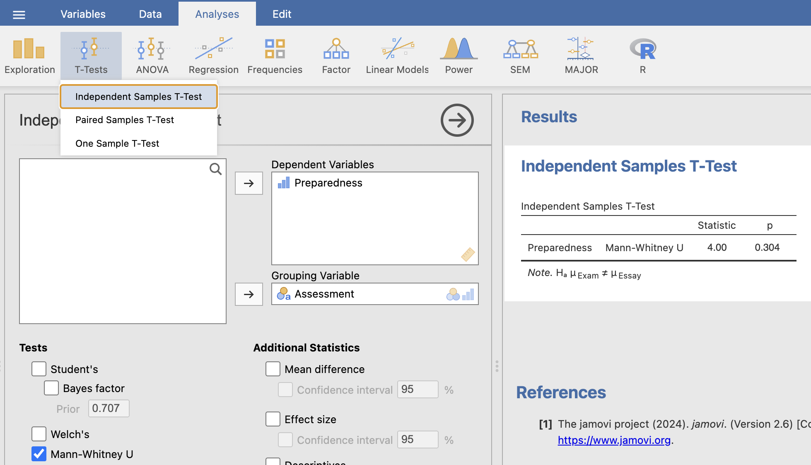
```
]

---
### Comparing Independent Groups


**Kruskal-Wallis Test: 3+ Independent Groups**

.center[
```{r, echo = F, out.width='75%'}
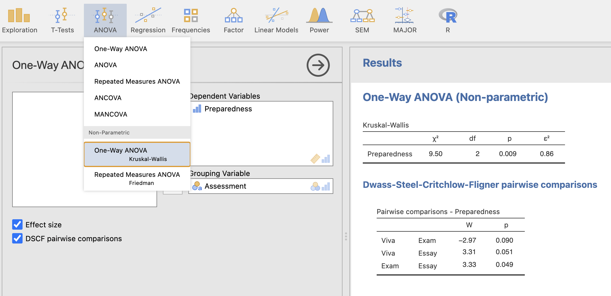
```
]

---
### Comparing Paired/Dependent Groups

+ Similar procedure to independent groups tests, but ranks the differences between two groups when the observations are matched

+ Assigns negative ranks or positive ranks depending upon which of the paired values is larger 

```{r, echo = F}
pairedGroups <- data.frame(Exam = c(2, 3, 4, 3, 5, 6, 3),
                       Essay = c(7, 5, 2, 4, 4, 3, 6))

pairedGroups$Diff <- pairedGroups$Exam - pairedGroups$Essay

rankedPaired <- pairedGroups %>%
  arrange(desc(abs(Diff)))

rankedPaired$Sign <- ifelse((rankedPaired$Exam - rankedPaired$Essay)>0, '+', '-')

```

<br>

.center[

|Exam Rating | Essay Rating | Difference | Rank | Sign |
|:-----------|:------------:|:----------:|:----:|:----:|
|`r rankedPaired$Exam[1]`|`r rankedPaired$Essay[1]`|`r rankedPaired$Diff[1]`|1|`r rankedPaired$Sign[1]`|
|`r rankedPaired$Exam[2]`|`r rankedPaired$Essay[2]`|`r rankedPaired$Diff[2]`|2|`r rankedPaired$Sign[2]`|
|`r rankedPaired$Exam[3]`|`r rankedPaired$Essay[3]`|`r rankedPaired$Diff[3]`|2|`r rankedPaired$Sign[3]`|
|`r rankedPaired$Exam[4]`|`r rankedPaired$Essay[4]`|`r rankedPaired$Diff[4]`|4|`r rankedPaired$Sign[4]`|
|`r rankedPaired$Exam[5]`|`r rankedPaired$Essay[5]`|`r rankedPaired$Diff[5]`|4|`r rankedPaired$Sign[5]`|
|`r rankedPaired$Exam[6]`|`r rankedPaired$Essay[6]`|`r rankedPaired$Diff[6]`|6|`r rankedPaired$Sign[6]`|
|`r rankedPaired$Exam[7]`|`r rankedPaired$Essay[7]`|`r rankedPaired$Diff[7]`|6|`r rankedPaired$Sign[7]`|

]

---
### Comparing Paired/Dependent Groups


**Wilcoxon Signed-Rank Test: 2 Paired/Dependent Groups**

.center[
```{r, echo = F, out.width='75%'}
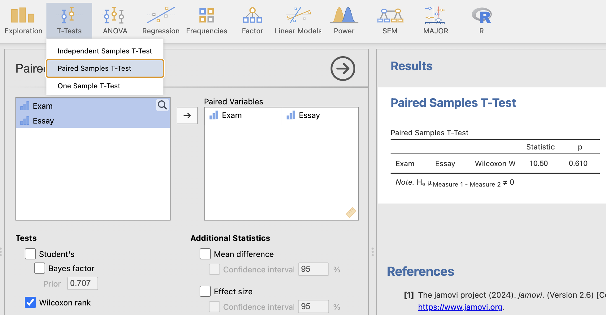
```
]

---
### Comparing Paired/Dependent Groups


**Friedman's ANOVA: 3+ Paired/Dependent Groups**

.center[
```{r, echo = F, out.width='75%'}
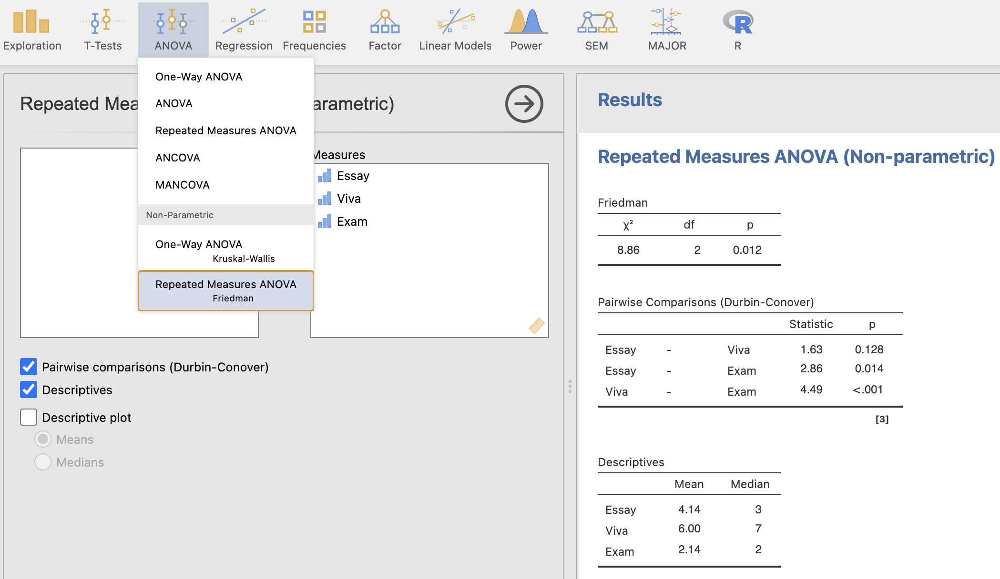
```
]

---
class: middle, center, inverse

## Questions?

---
### Nonparametric Test of Association

+ Spearman's $\rho$ is the nonparametric version of Pearson's $r$

+ Spearman's $\rho$ uses data on the rank-ordering of $x$, $y$ responses for each individual.

+ When to choose Spearman's $\rho$ over Pearson's $r$:
	+ Data are naturally ranked (e.g. a survey where the task is to rank foods and drinks in terms of preference)
	+ Data are ordinal (e.g., Likert Scales)
	+ Data are non-normal or skewed
	+ Data shows evidence of non-linearity

---
### Spearman's Correlation

+ Spearman's is not testing for linear relationships, but for increasing monotonic relationship.

--

  + What?

--

.pull-left.center[
**Perfectly Linear Relationship**
```{r, echo = F, fig.height=3, fig.width=5}
mono <- data.frame(
  A = c(1,2,3,4,5,6,7),
  B = c(1,2,3,4,5,6,7),
  C = c(1,4,5,6,8,9,10)
)

lp <- mono %>%
  ggplot(., aes(x=A, y=B)) +
  geom_point() + 
  geom_line()

mp <- mono %>%
  ggplot(., aes(x=A, y=C)) +
  geom_point() + 
  geom_line()

lp
```

]

.pull-right.center[
**Perfectly Increasing Monotonic Relationship**
```{r, echo = F, fig.height=3, fig.width=5}
mp
```

]

---
### Spearman's Correlation

+ **Perfect Monotonic Relationship:** The rank positions of `Prepared` ratings are the same as the rank positions of all `CourseQuality` ratings.

.pull-left[

```{r, echo = F}
colnames(mono) <- c('Prepared', 'B', 'CourseQuality')

mono %>%
  mutate(
    PreparedRank = rank(Prepared),
    CourseQualityRank = rank(CourseQuality)
  ) %>%
  dplyr::select(., Prepared, CourseQuality, PreparedRank, CourseQualityRank) %>%
  kable() %>%
  kable_styling(full_width = F)

```

]

.pull-right.center[
```{r, echo = F, fig.height=3, fig.width=4}
mp + labs(x = 'Prepared', y = 'Course Quality') +
  scale_y_continuous(breaks = seq(0, 10, by = 2)) +
  scale_x_continuous(breaks = seq(1, 7, by = 1))
```

]

---
### Spearman's Correlation


```{r, echo = F, out.width='75%'}
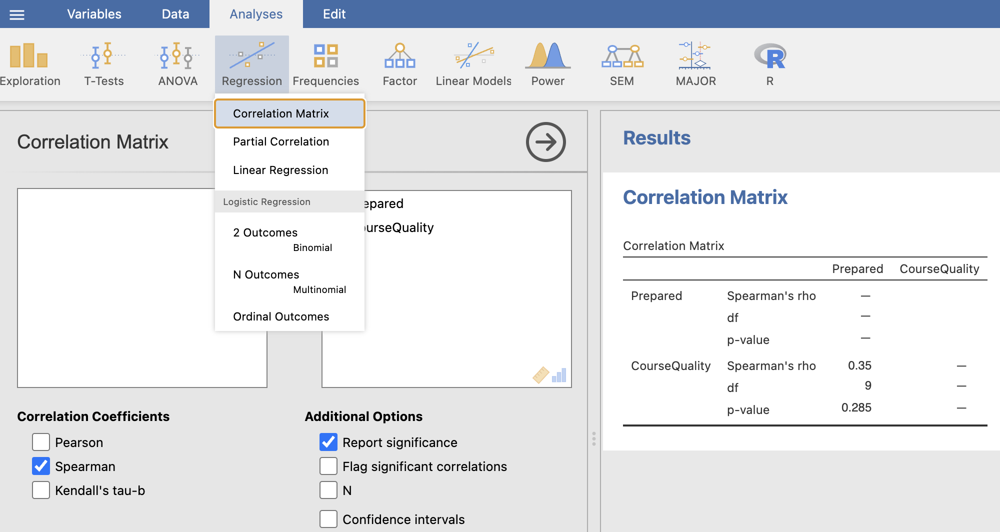
```

+ Interpretation is identical to Pearson's $r$ and same thresholds can be used

---
class: inverse, center, middle

## Questions?

---
### $\chi^2$ Tests

+ Used for testing frequencies (counts) in categorical variables that have more than 2 levels

  + ** $\chi^2$ Goodness of Fit Test**: Are data distributed in an expected way?

  + ** $\chi^2$ Test of Independence**: Are two categorical variables from a single population independent of each other?

--

+ In both tests, a $\chi^2$ statistic is calculated and compared against an expected distribution

+ The probability of a $\chi^2$ as extreme as this value is calculated

+ Using this probability, a decision is made in regards to the null hypothesis.

---
### $\chi^2$ Goodness of Fit Test

.pull-left[

+ Tests the null hypothesis that the number of observations within groups of a variable are consistent with expectations

+ **Hypotheses:**
  + $H_0: n_i = m_i$
  + $H_1: n_i \neq m_i$

    + $n_i$ = the number of observations in category $i$
    + $m_i$ = the expected number of observations in category $i$

]

.pull-right[
```{r, echo = F}
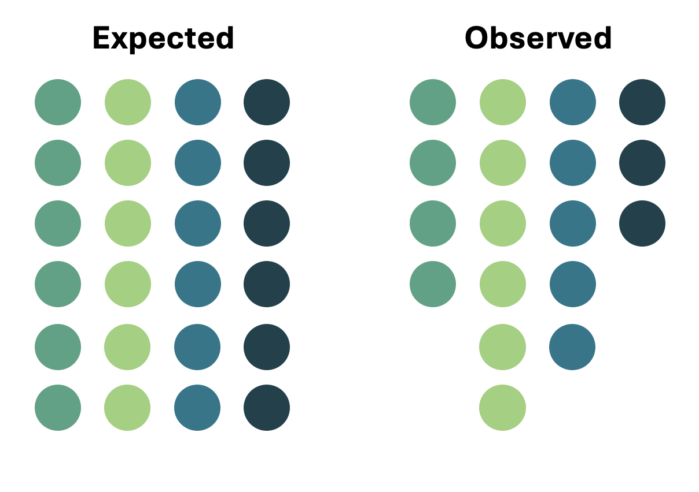
```
]

---
### What is 'expected'?


+ Based on an understanding of the variable and how it is expected to be distributed in the population.

  + Sometimes, it may be reasonable to expect that observations are evenly distributed between groups 
      + Number of times fair dice rolls each number between 1 and 12

  + Other times, there may be an expectation that groups are distributed unevenly 
      + Handedness: 85% right-handed, 13% left-handed, 2% ambidextrous
  
+ If the $\chi^2$ value is significant, the observed data don't align with what is expected under the null hypothesis.


---
### Example - $\chi^2$ Goodness of Fit

.pull-left[
.center[
```{r, echo = F, out.width='60%'}
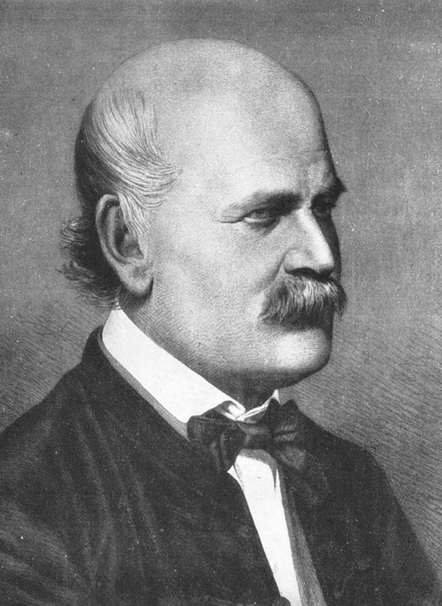
```
]]

--

.pull-right[

<br>

|  Day    | Mortality of Mothers |
|:-------:|:--------------------:|
| Hospital          | 111        |
| Teaching Hospital | 114        |
| Midwifery Unit    | 32         |

*Is the mortality rate distributed across facilities in a way we would expect?*

]

---
### Example - $\chi^2$ Goodness of Fit Results

.pull-left[
 

Null Hypothesis: The mortality rate between facilities is distributed as expected.
  + In this case, if facility has nothing to do with mortality rate, we would expect the mortality rate to be similar between facilities.
  + $H_0: n_{mortality} = m_{mortality}$
  
Alternative Hypothesis: The mortality rate between facilities is not distributed as expected
  + $H_1: n_{mortality} \neq m_{mortality}$

**Are there differences in mortality between facilities?**
]
.pull-right[
.center[
```{r, echo = F, out.width='80%'}
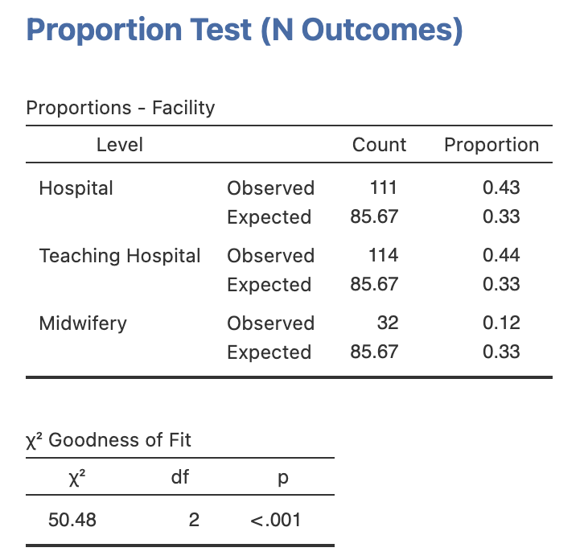
```
]]

---
### Example - $\chi^2$ Goodness of Fit Results

```{r, echo = F, out.width = '75%'}
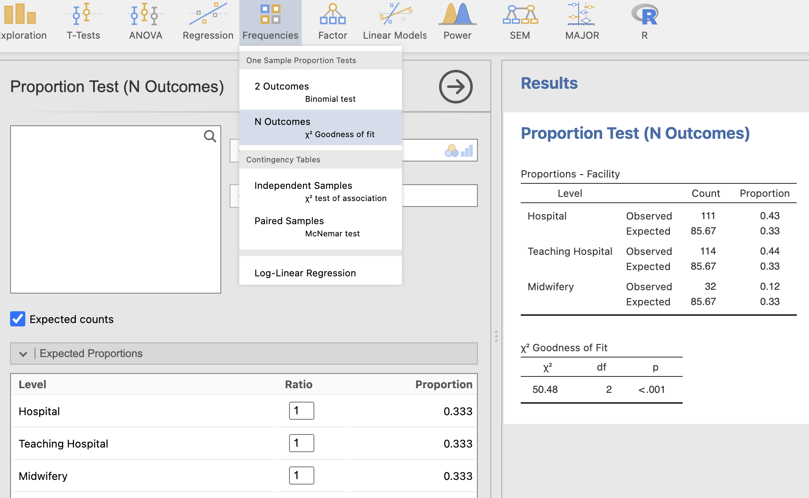
```

---
### $\chi^2$ Test of Independence

.pull-left[

+ Tests whether two categorical variables from a single population are independent of each other.

+ **Hypotheses:**
  + $H_0:$ Variable A is not associated with Variable B
  + $H_1:$ Variable A is associated with Variable B

]

.pull-right[
```{r, echo = F}
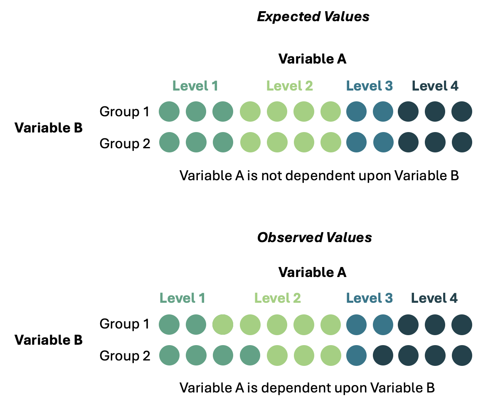
```
]
---
### Example - $\chi^2$ Test of Independence

.pull-left[
+ **Is maternal cause of death dependent on facility?**
  
  + $H_0$: Maternal cause of death will be independent of facility.
  
  + $H_1$: Maternal cause of death will be dependent on facility.
]

.pull-right[

|  Facility        |  Other Causes | Infection | Haemorrhage |
|:-----------------|:-------------:|:---------:|:-----------:|
|Hospital          | 34            | 48        | 18          |
|Teaching Hospital | 11            | 77        | 12          |
|Midwifery         | 38            | 12        | 50          |

]

---
### Example - $\chi^2$ Test of Independence Results

.center[
```{r, echo = F, out.width='70%'}
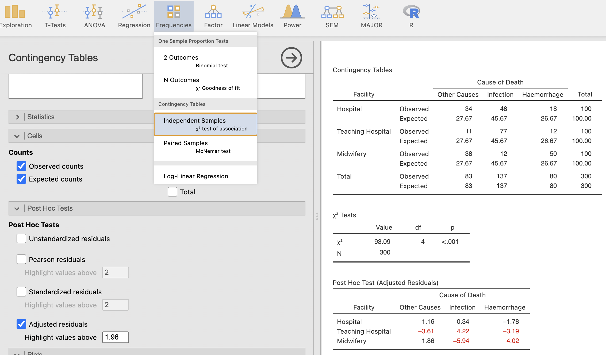
```
]

--
So, did Semmelweise radically change the field of medicine with his discovery?

---

class: middle, center, inverse

## Questions?

---

class: middle, center, inverse

## THANK YOU!!!!

---

<br>
.center[
```{r, echo = F, out.width='50%'}

```
]