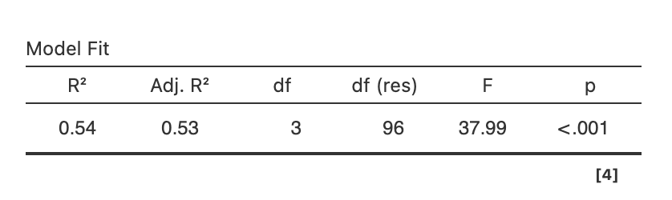
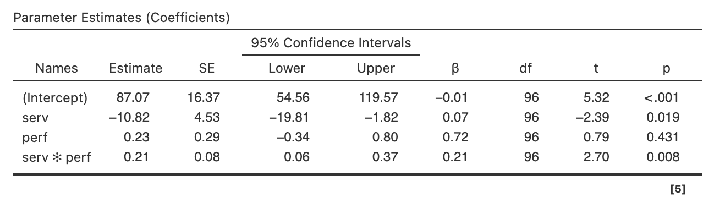
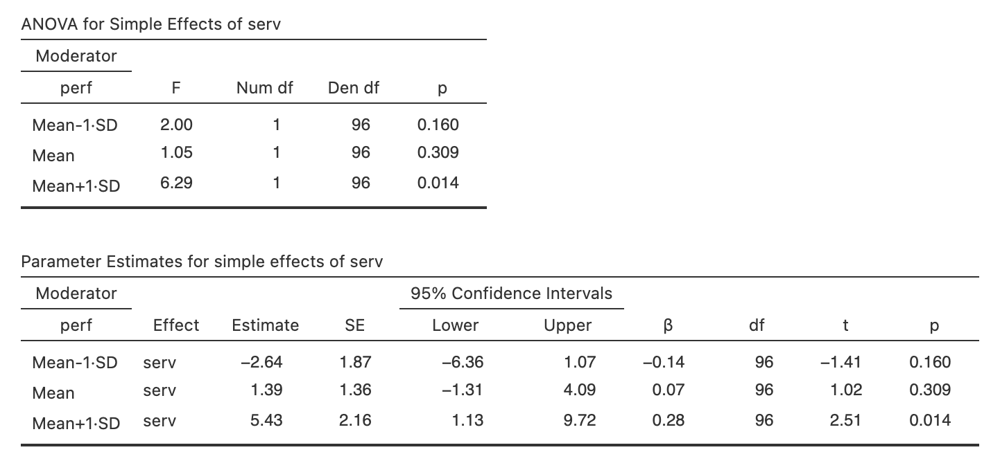
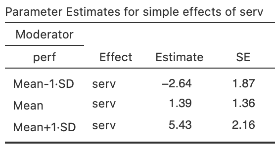
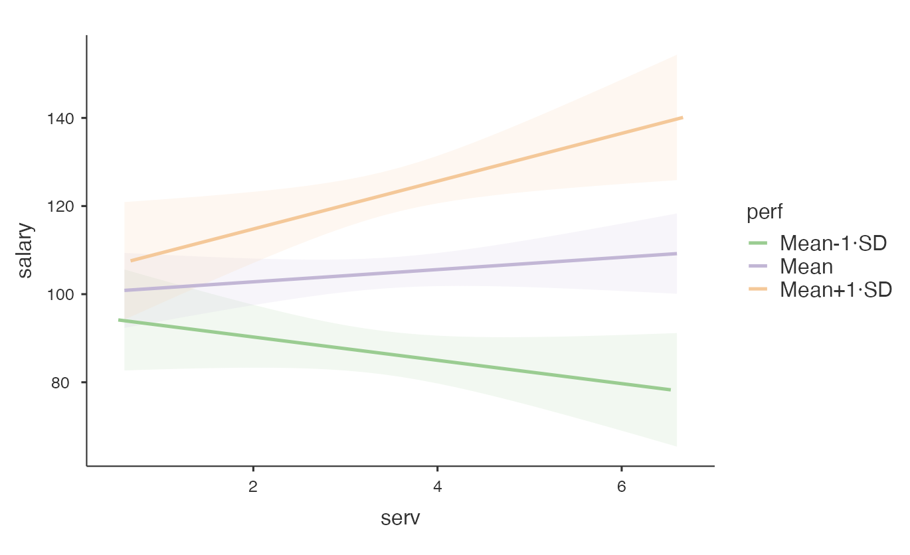
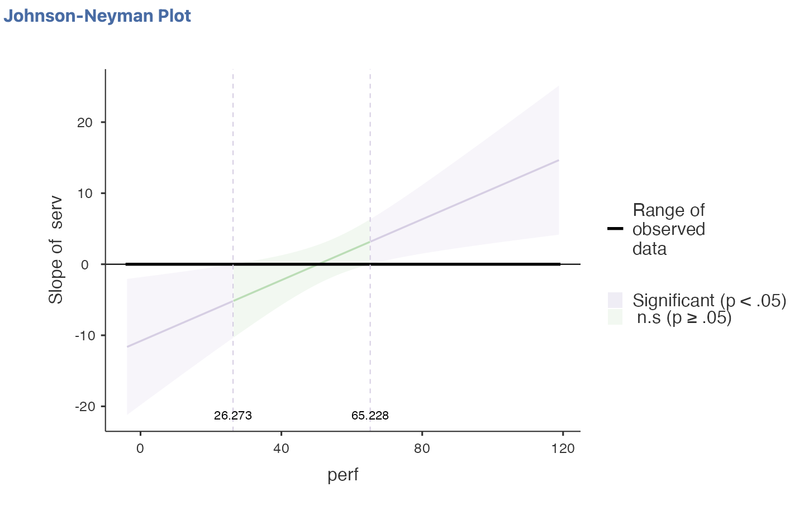

```{r setup, include=FALSE}
options(htmltools.dir.version = FALSE)
```

```{r xaringan-themer, include = FALSE}
library(xaringanthemer)
style_mono_accent(
  base_color = "#18778C",
  header_color = "#000000",
  header_font_google = google_font("Jost"),
  header_font_weight = 500,
  text_font_google = google_font("Jost", "300", "300i", "500", "500i"),
  code_font_google = google_font("Source Code Pro"),
  text_bold_color = '#4CA384',
  text_slide_number_color = '#18778C',
  text_font_size = '16pt'
)
```

```{r, echo = F, message = F, warning = F}
library(tidyverse)
library(kableExtra)

knitr::opts_chunk$set(dev = 'svg')

baseColor <- '#4CA384'
accent1 <- '#9AD079'
accent2 <- '#18778C'
accent3 <- '#19424C'
```

### This Week's Key Topics

+ Interactions between two continuous variables

+ Simple slopes analysis

+ Centering variables


---
### Interactions

.pull-left[

+ Recall that an **interaction** occurs when the effects of one predictor/IV on the outcome/DV change across levels of a second predictor/IV. 

+ Factorial ANOVA may be used to investigate categorical $\times$ categorical interactions


]
  
.pull-right[
```{r, echo = F, fig.width=5, fig.height=3.5}
intDat <- data.frame(int=c(rep('int1', 4), rep('int2', 4), rep('int3', 4), 
                           rep('meInt', 4), rep('noint', 4)), 
                     Sleep = rep(c('More', 'More', 'Less', 'Less'), 5), 
                     Stress = rep(c('High', 'Low', 'High', 'Low'), 5), 
                     SleepC = c(8, 9, 4, 5, 7,10, 3, 5, 8, 7, 4, 6, 9, 9, 5, 4, 8, 7, 5, 4),
                     Memory = c(4, 2, 2, 4, 2, 2, 2, 4, 3, 4, 2, 2, 3, 4, 2, 4, 2, 1, 4, 3))

intDat$Sleep <- factor(intDat$Sleep, levels=c('More', 'Less'))

ggplot(intDat[intDat$int=='meInt',], aes(Stress, Memory, color = Sleep, group = Sleep)) + geom_point() + geom_line() +
  scale_color_manual(values = c(baseColor, accent2)) +
  scale_y_continuous(limits = c(0,5), breaks = seq(0, 5, by = 1)) +
  labs(x = 'Stress', y = 'Memory', color = 'Sleep') +
  theme(legend.position = 'inside',
        legend.position.inside = c(.85, .8),
        axis.text = element_text(size = 12),
        axis.title = element_text(size = 14, face = 'bold'),
        legend.title = element_text(size = 12, face = 'bold'))
```

]
  
---
### Interactions

.pull-left[
+ This week, we'll cover interactions with continuous variables

  + The slope of the model line ($\beta_x$) between a continuous predictor and the outcome changes as the values of a second predictor change.

  + i.e., the association between predictor 1 and the outcome variable changes depending on the value of predictor 2. 
]

.pull-right[ 

```{r, echo = F, fig.height=3.5, fig.width=5, message = F, warning = F}
dat <- read.csv('http://mtruelovehill.github.io/PRM/Labs/RegressionLabData.csv')

dat$PhysicalActivitySplit <- ifelse(dat$PhysicalActivity>mean(dat$PhysicalActivity), 'High', 'Low')

ggplot(dat, aes(Sleep, Wellbeing, color = PhysicalActivitySplit, group = PhysicalActivitySplit)) + 
  geom_smooth(method = 'lm', se = F) +
  scale_color_manual(values = c(baseColor, accent2)) +
  labs(x = 'Sleep', y = 'Memory', color = 'Stress') +
  theme(legend.position = 'inside',
        legend.position.inside = c(.75, .25),
        axis.text = element_text(size = 12),
        axis.title = element_text(size = 14, face = 'bold'),
        legend.title = element_text(size = 12, face = 'bold'))
```

]
---
### Expanding on Multiple Linear Regression

Recall the linear regression equation from last week:

$$y_i = \beta_0 + \beta_1x_i + \epsilon_i$$
Where:

.pull-left[
$y_i$: an individual's score on the outcome variable

$x_i$: an individual's score on predictor $x$

$\epsilon_i$: an individual's residual
]

.pull-right[
$\beta_0$: the model's intercept

$\beta_1:$ the model's slope
]


---
### Expanding on Multiple Linear Regression

We can expand this further to include multiple variables:

$$y_i = \beta_0 + \beta_1x_i + \beta_2z_i + \epsilon_i$$

Where:

.pull-left[

$y_i$: an individual's score on the outcome variable

$x_i$: an individual's score on predictor $x$

$z_i$: an individual's score on predictor $z$

$\epsilon_i$: an individual's residual

]

.pull-right[
$\beta_0$: the model's intercept

$\beta_1:$ the slope associated with $x$

$\beta_2:$ the slope associated with $z$
]


---

### Expanding on Multiple Linear Regression

We can expand even further to include the interaction between these variables:

$$y_i = \beta_0 + \beta_1x_i + \beta_2z_i + \beta_3\color{#4CA384}{xz_i} + \epsilon_i$$

Where:

.pull-left[

$y_i$: an individual's score on the outcome variable

$x_i$: an individual's score on predictor $x$

$z_i$: an individual's score on predictor $z$

$xz_i$: an individual's interaction term for $x$ and $z$

$\epsilon_i$: an individual's residual

]

.pull-right[

$\beta_0$: the model's intercept

$\beta_1:$ the slope associated with $x$

$\beta_2:$ the slope associated with $z$

$\beta_3:$ the slope associated with the interaction

]

---
### Effects in Linear Regression Models


$$y_i = \beta_0 + \beta_1x_i + \beta_2z_i + \beta_3a_i + \color{#9AD079}{\beta_4}xz_i + \epsilon_i$$


<b><span style="color:#9AD079">Interaction Effect:</span></b> the simultaneous effect of multiple predictors on an outcome
  + An interaction effect indicates that the effect of one predictor on the outcome changes across values of the other predictor.


---
count: false

### Effects in Linear Regression Models


$$y_i = \beta_0 + \beta_1x_i + \beta_2z_i + \color{#4CA384}{\beta_3}a_i + \color{#9AD079}{\beta_4}xz_i + \epsilon_i$$


<b><span style="color:#9AD079">Interaction Effect:</span></b> the simultaneous effect of multiple predictors on an outcome
  + An interaction effect indicates that the effect of one predictor on the outcome changes across values of the other predictor.

<b><span style="color:#4CA384">Main Effects:</span></b> The effects of predictors that are not involved in the interaction
  + The effect of a predictor on the outcome variable *when the others predictors are held constant*

---
count: false

### Effects in Linear Regression Models


$$y_i = \beta_0 + \color{#18778C}{\beta_1}x_i + \color{#18778C}{\beta_2}z_i + \color{#4CA384}{\beta_3}a_i + \color{#9AD079}{\beta_4}xz_i + \epsilon_i$$


<b><span style="color:#9AD079">Interaction Effect:</span></b> the simultaneous effect of multiple predictors on an outcome
  + An interaction effect indicates that the effect of one predictor on the outcome changes across values of the other predictor.

<b><span style="color:#4CA384">Main Effects:</span></b> The effects of predictors that are not involved in the interaction
  + The effect of a predictor on the outcome variable *when the others predictors are held constant*

<b><span style="color:#18778C">Marginal Effects:</span></b> the individual effect of predictors that are part of the interaction
  + When an interaction between $x$ and $z$ is present, the effect of predictor $x$ changes as $z$ changes, so  $\beta_x$ is no longer interpreted in the same way as a main effect.
  + These effects are now considered *conditional* effects rather than main effects, as they are conditional upon the value of the other predictors. 
  + Reflect the effect of a predictor on the outcome variable when the *other interaction variables are equal to 0*


---
### Effects in Linear Regression Models

+ Consider the following equation:

$$Memory_i = \beta_0 + \beta_1Age_i + \beta_2SubstanceUse_i + \beta_3Stress_i + \beta_4Sleep_i + \beta_5Stress\times Sleep_i + \epsilon_i$$

<br>

> **Test Your Understanding:**

> + Which $\beta$ values reflect a **main effect**?

--

> + Which $\beta$ values reflect a **marginal effect**?

--

> + Which $\beta$ values reflect an **interaction**?


---
### Interpreting Continuous $\times$ Continuous Interactions

$$y_i = \beta_0 + \beta_1a_i + \beta_2x_i + \beta_3z_i + \beta_4xz_i + \epsilon_i$$
<br>

+ $\beta_0$/Intercept: value of $y$ when all predictors are equal to 0

+ $\beta_1$: Effect of $a$ on $y$ when $x$ and $z$ are held constant.

+ $\beta_2$: Effect of $x$ on $y$ when $z$ is equal to 0 and $a$ is held constant.

+ $\beta_3$: Effect of $z$ on $y$ when $x$ is equal to 0 and $a$ is held constant.

+ $\beta_4$: Change in slope of $x$ on $y$ across values of $z$ (and vice versa).

---
### Interpreting Continuous $\times$ Continuous Interactions

$$Memory_i = \beta_0 + \beta_1Age_i + \beta_2SubstanceUse_i + \beta_3Stress_i + \beta_4Sleep_i + \beta_5Stress\times Sleep_i + \epsilon_i$$

<br>

**Test your Understanding:** interpret in the context of the model variables

+ $\beta_0$/Intercept: value of $y$ when all predictors are equal to 0

+ $\beta_1$: Effect of $a$ on $y$ when $x$ and $z$ are held constant.

+ $\beta_2$: Effect of $x$ on $y$ when $z$ is equal to 0 and $a$ is held constant.

+ $\beta_3$: Effect of $z$ on $y$ when $x$ is equal to 0 and $a$ is held constant.

+ $\beta_4$: Change in slope of $x$ on $y$ across values of $z$ (and vice versa).

--

  + Usually easier to produce a visualisation to help with interpretation rather than trying to interpret the coefficient itself.


---
### Interpreting Continuous $\times$ Continuous Interactions


$$Memory_i = \beta_0 + \beta_1Age_i + \beta_2Stress_i + \beta_3Sleep_i + \beta_4Stress\times Sleep_i + \epsilon_i$$
<br>

**Test your Understanding:** interpret in the context of the model variables

+ $\beta_0$/Intercept: 22.10

+ $\beta_1$: -3.44

+ $\beta_2$: -1.68

+ $\beta_3$: 2.08


---
class: center, inverse, middle

## Questions?

---
### Issues with interpretation

+ Sometimes, 0 falls outside the meaningful scale of the variable

  + E.g., age or sleep

+ In these cases, the scaling of the variable may be adjusted so that 0 instead reflects a meaningful value

---
### Mean-Centering

.pull-left[
+ When data are mean-centered, the mean of each predictor is subtracted from each observation of that predictor.

  + $x_i - \bar{x}$

+ The mean of the mean-centered predictor will then be equal to 0.
  + Values > 0 reflect observations that are greater than the mean
  + Values < 0 reflect observations that are less than the mean
]

--

.pull-right[
Consider this example, where $\bar{x} = 5$:
```{r, echo = F}
set.seed(444)
mcDat <- data.frame(x = c(3, 6, 7, 2, 5, 7),
                    z = sample(1:10, size = 6, replace = T))
mcDat$xz = mcDat$x*mcDat$z

mcDat$xMC <- mcDat$x - mean(mcDat$x)
mcDat$zMC <- round(mcDat$z - mean(mcDat$z),2)
mcDat$xzMC <- round(mcDat$xMC*mcDat$zMC,2)

mcDat[,c('x', 'xMC')] %>%
  kable(col.names = c('x', 'x MC')) %>%
  kable_styling()
```
]


---
### Interpretation of Mean-Centered Variables

+ Mean-centering scales the variables so that the mean is equal to 0

+ The intercept of a linear regression model ( $\beta_0$) reflects the value of $y$ when all predictors are equal to 0.

+ A marginal effect $\beta$ reflects the effect of its predictor on the outcome when the other predictor involved in the interaction is equal to 0 and main effect variables are held constant.

+ A main effect $\beta$ reflects the effect of that predictor on the outcome when the other predictors are held constant.

--

> **Test Your Understanding:** When all predictors are mean-centered:

--

> How is the intercept interpreted?

--

> How is the $\beta$ of a predictor involved in an interaction interpreted?

--

> How is the $\beta$ of a predictor uninvolved in an interaction interpreted?

---
### Interpretation of Mean-Centered Variables


$$Memory_i = \beta_0 + \beta_1Stress_i + \beta_2Sleep_i + \beta_3Stress\times Sleep_i + \epsilon_i$$
<br>

+ If sleep is mean centered, how should the following be interpreted?

  + $\beta_0$/Intercept: 22.10

  + $\beta_1$: -1.68

  + $\beta_2$: 2.08

---
class: center, inverse, middle

## Questions?

---
### Today's Example

+ Download the data for today's example [here](https://mtruelovehill.github.io/PRM/Data/salaryDat.csv)

+ Key Variables:
  + `serv`: years of service at current place of employment
  + `perf`: most recent performance ratings
  + `salary`: current salary in thousands of pounds

+ Research Question: Does the association between years of service and salary differ based on job performance?


---
### Hypotheses

$$Salary_i = \beta_0+\beta_1Service_i+\beta_2Performance_i+\beta_3Service\times Performance_i$$


+ Null Hypothesis: The association between years of service on salary does not depend on job performance.

  + $H_0: \beta_3$ = 0

+ Alternative Hypothesis: The association between years of service on salary is dependent upon job performance.

  + $H_1: \beta_3 \neq$ 0


---
### Conducting Linear Regression with Interaction

.pull-left[
+ Install the `GAMLj3` module

+ Use *Linear Models > General Linear Model*

+ Predictors are automatically mean-centered
  + This will need to be changed if you would prefer their original scale
  
  + In this example output, the predictors are set at their original scale.
]

--

.pull-right[
```{r, echo = F}

```

```{r, echo = F}

```
]


---

### Simple Slopes Analysis

.pull-left[
+ A **simple slopes analysis** can be used to investigate continuous $\times$ continuous interactions further.

+ A significant interaction effect suggests that $\beta_x$ differs at varying levels of $z$ 

+ With simple slopes analysis, certain thresholds of $z$ are selected to investigate the relationship between $x$ and $y$.

+ The association between $x$ and $y$ is commonly investigated at:
  + $\bar{z} + 1\ SD_z$
  + $\bar{z}$
  + $\bar{z} - 1\ SD_z$
  
]

--

.pull-right.center[

$\bar{z} = 100$

$SD_z = 15$

```{r, echo = F, fig.height=5}
ggplot() + 
  scale_y_continuous(limits = c(-2, 6), breaks = seq(-2, 6, 1)) +
  scale_x_continuous(limits = c(0, 5)) + 
  labs(x = 'X', y = 'Y') +
  geom_abline(slope = 1, intercept = 0, color = baseColor, linewidth = 1) +
  geom_abline(slope = .5, intercept = 0, color = accent1, linewidth = 1) +
  geom_abline(slope = 0, intercept = 0, color = accent2, linewidth = 1) +
  annotate(geom = 'text', label = 'Z = 85', x = 4.5, y = 0.25, color = accent2, size = 5) +
  annotate(geom = 'text', label = 'Z = 100', x = 4.5, y = 2.75, color = accent1, size = 5) +
  annotate(geom = 'text', label = 'Z = 115', x = 4.5, y = 5, color = baseColor, size = 5) +
  theme(axis.text = element_blank(),
        axis.ticks = element_blank(),
        axis.title = element_text(size = 16, face = 'bold'))
```

]

---
### Simple Slopes in jamovi

```{r, echo = F}

```

---
### Simple Slopes in jamovi

.pull-left[
```{r, echo = F, out.width='85%'}

```
]

.pull-right[
```{r, echo = F}

```
]

---

### Johnson-Neyman plots

.pull-left[
+ A Johnson-Neyman plot can be used to further investigate significant interactions

+ It identifies the specific regions of $z$ where the relationship between $x$ and $y$ is significant
]

.pull-right[
```{r, echo = F}

```
]

---
class: center, inverse, middle

## Questions?


